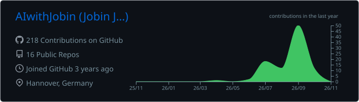
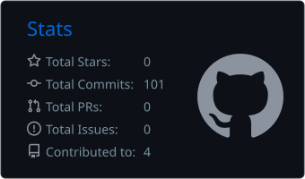
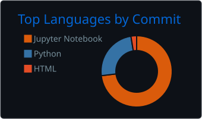

<!-- Header banner -->

  

<!-- Animated typing line -->

  

  
  
  
  

---

### 👋 About me

I build **production GenAI systems**: multi-agent assistants, RAG with hybrid retrieval, and the evaluation pipelines that keep them honest. I also ship **backends in Kotlin/Spring Boot and Python**.

- 🎓 M.Sc. Computer Science @ Leibniz Universität Hannover
- 🔬 Research Assistant (HiWi), Mineralogy, LUH: deep learning on spectral data
- 💼 Previously: AI Engineer @ Propmarker · Software Engineer @ Layer One GmbH
- ⏱️ Available up to 20 h/week in the semester, full-time in breaks

---

### 🚀 Featured work
Click a project to expand it

<b>🤖 Lenah: production multi-agent assistant</b> · LangGraph · RAG · RAGAS <i>(Propmarker, private)</i>

 

| Metric | Result |
|---|---|
| Traffic | **~7,000 queries / month** |
| Retrieval (BM25 + dense vs dense-only) | **~30% higher precision** |
| RAGAS Faithfulness (150-question golden set) | **≥ 0.90** |
| Cost & latency (routing, caching, context trimming) | **~35% lower** |

Orchestrator plus tool-using sub-agents that query production MongoDB through a read-only replica, with the schema retrieved via RAG. Includes guardrails, prompt-injection defence and human-in-the-loop.

<b>🔨 Auction platform</b> · Kotlin · Spring Boot · PostgreSQL <i>(Layer One)</i>

 

Lifecycle state machine and scheduler, **concurrency-safe bidding with row locking**, idempotency keys, an audit log, participant invitations with token verification, and broker views. REST APIs follow RFC 9457.

<b>⏱️ HourTracking</b> · Next.js · TypeScript · Supabase <i>(Layer One)</i>

 

A full-stack app for recording working hours, booking office desks, generating payout PDFs and tracking payments. Integrates Notion, Asana and Supabase role-based login, with Docker and CI.

<b>🔗 finAPI connector</b> · Webhooks · PostgreSQL · Notion <i>(Layer One)</i>

 

Connects company bank accounts via finAPI and syncs accounts and transactions to Postgres and Notion, with automatic transaction classification. Delivered in **12 pull requests within three weeks**.

<b>🔬 Spectral dimensionality reduction</b> · PyTorch · GPU <i>(LUH Mineralogy)</i>

 

Reduces **4096-channel SEM-EDS spectra (~73 GB)**. A reproducible multi-seed benchmark compares autoencoders, a spectral transformer, PCA and KL-NMF, using a Poisson count-splitting objective and label-free metrics.

---

### 🌐 Connect With Me

  
  
  

---

### 🛠️ Tech Stack

#### 🤖 AI & GenAI

  
  
  
  
  
  
  
  

#### 💻 Languages & Frameworks

  
  
  
  
  
  
  
  
  

#### 🗄️ Databases & Vector Stores

  
  
  
  
  
  

#### 🛠️ Tools & Platforms

  
  
  
  
  
  

---

### 📊 GitHub stats

  

  
  

  

<!-- Contribution snake (generated daily by .github/workflows/snake.yml) -->

  <picture>
    <source media="(prefers-color-scheme: dark)" srcset="https://raw.githubusercontent.com/AIwithJobin/AIwithJobin/output/github-snake-dark.svg" />
    
  </picture>

